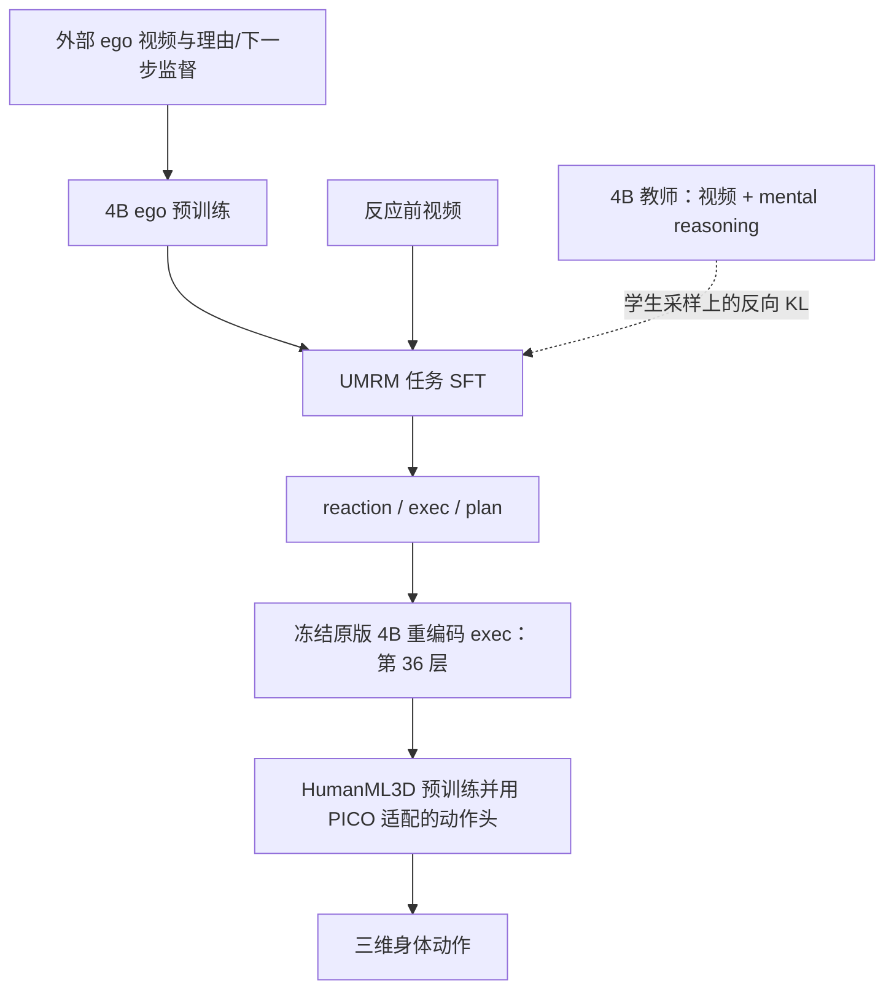

# UMRM-OPD

**第一人称反应预测：Qwen3-VL-4B → 反应文本 → 三维动作，以及带 mental reasoning 教师的 on-policy 蒸馏。**

本仓库整理自 **2026-10-15（周四）起**的路线探索，包含统一实现、原实验脚本快照、事先登记、汇总结果和后续 ego 能力保留实验。代码源自本地 `umrm-vho`；来源版本与文件哈希见 [SOURCE_SNAPSHOT.json](docs/SOURCE_SNAPSHOT.json)。

## 路线与当前结论



- **双重目标**：ego 数据增强视频到反应文本的推理能力，改善后续动作；同时让学生更能吸收带 mental reasoning 教师的指导。
- **已建立的链路**：V→T→M；当前参照为 SFT→A36，VAL R@10 **0.2907**。A36 取 caption token 的最后一层隐状态，不是最后一个 token。
- **已完成的 ego 实验**：PT-C 的 EgoNormia 53%→67%；经过任务 SFT 后为61.5%。动作 R@10为0.3040，差异区间跨0；尚未建立稳定下游收益。
- **当前问题**：SFT 是否保留 ego 能力，以及保留后 OPD 的增益是否更大。ER19已在原服务器启动；本仓库不宣称它已完成。
- OPD 更新学生语言侧 LoRA，教师和动作头冻结。`--lam_fwd 0` 为纯反向 KL；默认0.5是混合 KL。

正式任务是 `(pre-reaction video, current_state) → reaction → 3D motion`。本实验实现目前为 **clip-only**，未显式输入 current_state。正式 benchmark 为 **636**；v860/v1197/v1197aug 是独立实验口径，182条TEST保持封存。

## 从哪里读起

| 目的 | 入口 |
|---|---|
| 准备路线与实验汇报 | [详细报告](docs/reports/2026-10-19/BRIEFING.md)、[24页主讲+8页备份提纲](docs/reports/2026-10-19/SLIDE_OUTLINE.md)，附可复现PNG/SVG图 |
| 按日期了解路线如何变化 | [实验时间线](docs/EXPERIMENTS.md) |
| 理解架构、假设与实现边界 | [最新路线记录](docs/TAKEOVER_20261019.md) |
| 学习每个模块的数据流 | [教程](docs/TUTORIAL.md)，其中历史判断以最新路线记录为准 |
| 查看完整 ego 结果 | [Ego 预训练分析](docs/results/ego_pretrain_20261019/REPORT.md) |
| 查看本轮 SFT保留→匹配OPD设计 | [ER19 登记](docs/prereg/ego_retention_opd_20261019.md) |
| 配置环境、运行与复现 | [运行指南](docs/RUNNING.md)、[环境](envs/README.md) |
| 了解数据访问和存储 | [资产说明](docs/ASSETS.md)、[数据卡](docs/DATA.md) |
| 维护、提交和追溯 | [CONTRIBUTING.md](CONTRIBUTING.md)、[代码来源说明](NOTICE.md) |
| 为ego视频补录反应动捕做精确切片 | [ego数据反应标注台](tools/ego_reaction_desk/README.md)：独立小批候选、原反应预填、兼容交接表导出 |

## 目录

```text
pipeline/       统一实现：缓存、SFT、ego预训练、OPD、动作头、推理与评测
analysis/       汇总与统计；历史脚本的运行位置见该目录 README
experiments/    v860 / v1197 / v1197aug / lastlayer 原脚本快照
docs/prereg/   事先登记（保留历史条件与失败结果）
docs/results/  汇总结果、统计与曲线
tools/         发布辅助、ER19后台队列、仓库静态检查
configs/       配置模板；实际 paths.env 只在本机保存
envs/          Qwen / HERO / Kimodo 三套环境清单
third_party/   适配后的 UMRM 评测胶水；外部模型工程另行安装
```

## 最小检查

无需模型、数据或 GPU：

```bash
git clone https://github.com/shy123-arch/UMRM-OPD.git
cd UMRM-OPD
python tools/check_repository.py
```

带 PyTorch 和 NumPy 的 CPU 环境可再运行：

```bash
python analysis/test_retention_opd.py
```

训练需要独立获取模型、数据与环境。详见[运行指南](docs/RUNNING.md)。`pipeline/train.sh` 保留旧 A/AB + 混合KL 流程；A36、ego 和 ER19 使用各自显式配置。

## 发布范围

GitHub 收录代码、设计记录和汇总实验结果。数据集、mental reasoning逐样本标注、视频、动捕、权重、运行日志与缓存由外部存储管理。Ego4D主视频库在原服务器OSS挂载上；部分EgoRe资产及缓存仍在本地，尚未全量迁至OSS。代码公开不授予数据或第三方权重的使用许可，见 [ASSETS.md](docs/ASSETS.md) 与 [NOTICE.md](NOTICE.md)。
