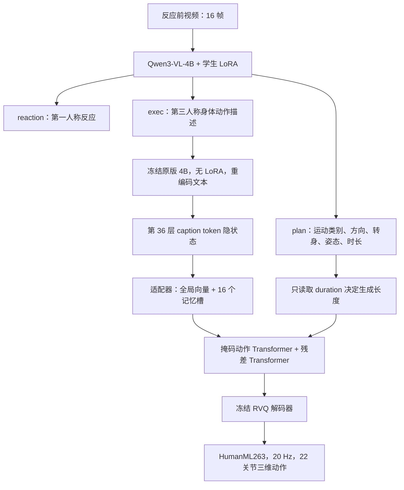
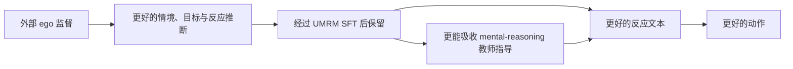
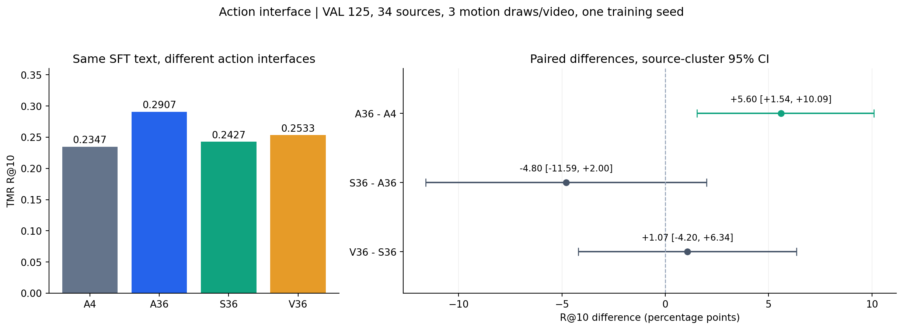
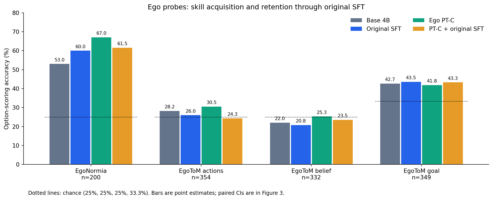
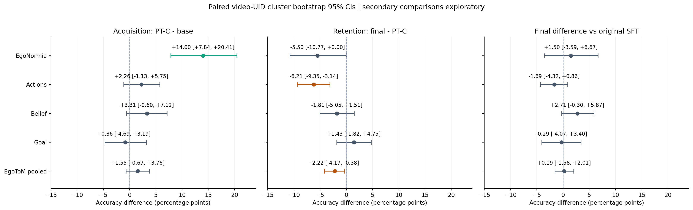
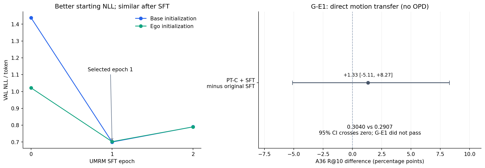

# UMRM：从视频反应推理到三维动作，以及 ego 预训练与 OPD 蒸馏

## 汇报信息与阅读方式

**覆盖时间：2026 年 10 月 15 日（周四）至 10 月 19 日。** 本文依据已完成的训练、评测、事先登记和汇总产物编写。运行状态核查时间为 **2026-10-19 13:26 北京时间（05:26 UTC）**：ER19 仍在两臂 SFT 阶段，正式匹配 OPD 尚未开始；本文不预报其结果。

本文分为五部分：问题与总体路线；实现和评测口径；逐轮实验；ego 预训练深入分析；当前验证及后续判断。可配合 [逐页汇报提纲](SLIDE_OUTLINE.md) 使用。图表提供 PNG、SVG 和 [绘图数据](figures/plotted_values.json)，可直接插入幻灯片。

**数字约定**：R@10 使用 0–1 比例；“百分点”用于两个比例的差。例如 0.2907→0.3040 是 +0.0133，即 +1.33 个百分点。文中区间为 95% CI；不同数据版本、执行器的绝对分数不放在同一排行榜里。历史报告中的机制解释经过重新审视，本文明确区分测量事实、解释假设和待验证问题。

---

## 1. 可以直接用于开场的总结

我们的目标是：让模型根据反应发生前的视频情境，预测一个合理的身体反应，并生成对应的三维动作。当前选择 Qwen3-VL-4B 作为视频理解与反应文本生成模型，把“理解情境、决定做什么”和“把动作语义实现为身体运动”分段学习，再用带人工 mental reasoning 的教师提升学生。

从周四以来，我们已经建立视频→反应文本→动作的完整链路，验证了 HumanML3D 预训练动作头的可用性，并选出冻结原版 4B、读取最后一层文本隐状态的 A36 接口作为当前固定读数。随后多轮 OPD 实验表明：学生能够向教师分布靠拢，但这种靠拢没有稳定转化为更好的下游动作。部分配置出现正信号，也出现退化；不能用一个“蒸馏有效/无效”的判断概括所有实验。

当前重点假设是：学生对第一人称情境、目标、意图和下一步反应的理解基础不足，可能限制了它吸收 mental-reasoning 教师的能力。因此，我们用外部 ego 数据做继续预训练，既希望直接改善视频到反应文本，再改善动作，也希望增加后续 OPD 的有效收益。

首轮 ego 实验已经得到分阶段证据：预训练将 EgoNormia 从 53% 提高到 67%；但进入原有 UMRM SFT 后降到 61.5%，EgoToM actions 也明显回落。最终动作 R@10 为 0.3040，相对 0.2907 的差异区间跨零，尚未建立稳定下游收益。因此，当前正在检验“能力能否经过 SFT 保留”，并用固定教师、同一蒸馏配方比较有无 ego 初始化的 OPD 增益。

**现在可以说：部分 ego 能力可训练，原配方 SFT 后的行为增益明显减弱。现在还不能说：ego 已经改善动作，或者已经改善 OPD。**

## 2. 研究问题：为什么需要这条路线

### 2.1 正式任务

正式定义为：

`(pre-reaction video, current state) → reaction → 3D motion`

它要求前瞻地判断“此刻可以立即做什么”。例如，模型需要根据反应前已经出现的人、物体、空间关系和事件，预测合理的身体反应。它不应依赖反应发生后的画面来解释已经发生的动作。

**当前实现边界**：这批实验的学生输入是 clip-only，尚未显式接入 current_state。因此汇报时应同时说明正式目标和当前实现；不能说已经实现完整的状态条件反应预测。

### 2.2 两种能力的训练来源不同

| 能力 | 主要难点 | 当前监督来源 | 直接产物 |
|---|---|---|---|
| 视频→反应文本 | 发现与反应相关的线索，理解当前目标，推断合理反应 | UMRM 任务 SFT；外部 ego 继续预训练；后续 OPD | reaction、exec、plan |
| 文本→三维动作 | 将语言动作语义变为连续、合理的身体运动 | HumanML3D 文本—动作预训练；PICO 动捕适配 | 动作 token 与 22 关节运动 |

分段训练使两类数据都能发挥作用：大量文本—动作数据帮助建立运动先验，视频—理由/下一步数据帮助学习情境推断，数量较少的 UMRM 样本负责把它们连接到目标任务。

这个设计也方便定位错误：可以检查视频理解是否写错了反应、文本接口是否损失信息、动作头是否没有执行正确语义，而不是只看最终动作分数。

### 2.3 原始设想与当前落地

| 最初设想 | 当前实现 | 仍待验证或扩展 |
|---|---|---|
| 使用 QwenVL 4B | Qwen3-VL-4B-Instruct | 4B 的优势是实验成本和迭代速度；不是已证实的最优容量 |
| 先 SFT，再接动作头 | V→T 与 T→M 分段训练，部署时串联 | 尚未做动作损失回传 VLM 的联合训练 |
| HumanML3D/ego 动作数据预训练并重定向 | HumanML3D 预训练；PICO→HumanML263 表示适配 | ego 文本预训练本身不含三维动作监督；尚未完成新的 ego 动捕迁移 |
| 用最后一层语义驱动动作 | A36：冻结原版 4B 重读 exec，取第 36 层 caption token 隐状态 | “学生看视频时的最后层”是 V36，已测但未建立优势 |
| LoRA 可选 | 现有语言侧实验均主要使用 LoRA | 没有完成 LoRA 与全参数训练的匹配消融 |
| 同尺寸 4B 自蒸馏、反向 KL | 固定独立教师 LoRA，学生 on-policy 采样，token 分布 KL | 不是动态更新的在线教师；历史有混合 KL，当前 ER19 为纯反向 |
| ego 能力帮助动作和蒸馏 | PT-C 已完成；保留实验和匹配 OPD 正在执行 | 直接动作收益、OPD 增益尚未证实 |

## 3. 当前系统如何工作

### 3.1 推理链路



视频均匀抽取 16 帧，单帧缩放到不超过 360×640，视觉特征使用已有缓存。语言模型生成三行结构化文本：

- `reaction`：第一人称表达“我要做什么”，用于任务监督和反应诊断。
- `exec`：以 “A person…” 为形式、通常限制在 30 词以内的身体动作描述，实际提供给动作头。
- `plan`：locomotion、direction、turn、posture、duration 等离散字段。

**A36 当前只把 plan 的 duration 直接送给动作生成器。** direction 等字段是诊断输出，并非显式轨迹约束。方向字段退化可能提示模型行为变化，但不能把它直接当作动作轨迹变化的充分原因。

### 3.2 “最后一层”到底是什么

A36 先让带学生 LoRA 的 VLM 看视频、写 exec，再用冻结的原版 4B 重新读取 exec 文本。取第 36 层中 **caption 各 token 的隐状态序列**，不是最后一个 token，也不是词表 logits。

接口形状可以写成：

`[L, 2560] → LayerNorm + MLP(2560→512→512) → 全局向量[512] + 记忆槽[16,512]`

生成侧的 LoRA 用于改善视频到文本；A36 编码侧不带该 LoRA。这样后续改变学生、做 ego 预训练或 OPD 时，动作语义接口和动作头保持固定，读数更容易解释。

### 3.3 动作头与表示

动作头沿用 HERO/ViMo、MoMask 一系的离散动作建模方式：

1. RVQ 将动作表示为多层离散代码；当前有 6 个量化层，时间压缩 4 倍。
2. 掩码 Transformer 生成基础动作代码。
3. 残差 Transformer 依次生成其余量化层，补足细节。
4. RVQ 解码为 HumanML3D 263 维运动特征，再恢复 22 关节坐标。

动作头先在 HumanML3D 上预训练约 60,000 步，再用 PICO 适配数据微调；PICO 微调计划最多 3,000 步，但最佳验证点通常在 200–300 步，显示小样本过拟合较快。训练动作头时 RVQ 冻结。

HumanML263 是表示转换和人体运动适配，不能直接称为“机器人重定向已完成”。当前输出也不是原生 24 关节控制接口。

完整事件训练目标最长 196 帧，即 9.8 秒；当前部署长度仍由离散 duration 决定，最高 88 帧，即 4.4 秒。帧数按 4 的倍数量化。例如 2.5 秒对应 50 帧，实际生成 48 帧/12 个动作 token。默认掩码采样 18 步、CFG 4，残差 CFG 5。

### 3.4 哪些参数在学习

| 阶段 | 更新 | 冻结 | 损失 |
|---|---|---|---|
| HumanML3D 动作预训练/PICO 适配 | 语义适配器、动作 Transformer | 文本编码器、RVQ | 离散动作预测损失 |
| UMRM 学生 SFT | 语言侧 LoRA | 视觉塔与基座权重 | 目标文本交叉熵 |
| ego PT-C | 语言侧 LoRA | 视觉塔与基座权重 | ego 理由/下一步文本交叉熵 |
| 教师 SFT | 教师独立 LoRA | 视觉塔与基座权重 | 带特权输入的目标文本交叉熵 |
| OPD | 学生语言侧 LoRA | 教师、动作头、视觉塔与基座权重 | 学生轨迹上的 token 分布 KL |

语言 LoRA 为 r16、alpha32、dropout0.05，覆盖 36 层中每层 7 个线性模块，共 252 个模块。**当前 OPD 不调用动作生成器训练，也不对动作 token 做 KL，更没有动作梯度回传 VLM。** 动作头在评测时检验文本变化有没有转成有用运动。

## 4. OPD 的方法与我们真正想蒸馏的东西

### 4.1 师生看到的信息不同

学生看到部署时可获得的视频 `x`。教师在训练时额外看到 `z`，不同版本的 z 包括真实运动学信息、人工 mental reasoning、抽取式观察信息、因果链等。当前 ER19 固定为人工完整 mental reasoning，不带运动学真值、不带生成 reason。

学生不会直接读教师 reason；它通过教师在自身回答前缀上的概率分布得到监督。教师即使与学生同为 4B，也可以因为训练目标和可用上下文不同而产生更有帮助的分布。参数规模相同并不妨碍蒸馏，但教师必须在相关任务上提供有用指导。

### 4.2 当前实现的目标

先从学生采样回答 `y ~ Sθ(.|x)`。对符合条件的 token 位置 t，计算：

`Lrev = mean_t KL[Sθ(.|x,y<t) || Tφ(.|x,z,y<t)]`

其中教师 φ 固定；采样前缀作为固定上下文参与本次更新。KL 对完整词表计算，不只是对已采样 token 计算一个分数。当前 ER19 只在 reaction、exec 范围计算，排除 plan 和结束段。

历史部分版本使用：

`L = (1−λ) Lrev + λ Lfwd`

λ=0 是纯反向 KL；λ=0.5 是等权混合。代码默认值和具体实验配置必须区分。这个实现是学生 rollout 上的局部 token 分布目标，不应描述为完整序列级 REINFORCE 或动作强化学习。

### 4.3 ego 假设的两条作用路径



路径一是直接收益：同一场景下写出更合适的反应/动作描述，固定动作头便可能输出更合适的动作。

路径二是蒸馏收益：更好的学生可能产生更相关的 rollout、更能解释视频线索，也更容易接受教师在相关语义上的概率修正。这是合理机制假设，目前没有通过匹配对照证实。

这里要区分两类困难：某些信息已经存在于输入中但模型不会利用，ego 训练可能帮助；另一些信息属于私人意图、未来事件或未输入音频，部署学生无法从现有输入唯一恢复。我们的目标是改善前一类，不能默认任何特权信息都能无损转移。

## 5. 数据版本与评测：如何保证数字不混淆

### 5.1 数据身份

| 数据口径 | 内容/规模 | 本文用途 |
|---|---|---|
| 正式 motion-backed benchmark | 636 条已审核且有可用 PICO 动捕 | 正式数据身份；不能用实验扩展集替换 |
| 历史 642 | 历史整合口径 | 仅溯源 |
| v860 | TRAIN582 / VAL96（25 来源）/ TEST182 | 周四链路、动作头和 OPD v1 |
| v1197 | TRAIN840 / VAL125（34 来源）/ 新来源封存50 / TEST182 | 周五扩展和 OPD v2 |
| v1197aug | TRAIN1652=840真实+812镜像；VAL125 | 后续主要探索 |
| 外部 ego PT-C | 实际训练19,242；探针1,235 | 能力注入与保留诊断 |

镜像联合翻转视频、动作及左右文本；28 条存在 left/right 语义歧义的训练样本没有镜像。镜像增加训练呈现，不等于增加了 812 个独立现实场景。

50 条新来源封存块已用于历史 C2 复核，因此不能继续称为未使用测试集。182 条 TEST 在这条路线中保持封存；历史数据清单另记录其中影视片段的评测资格排除规则，汇报中的 TEST182 表示封存 split 的规模，不表示已评测 182 条。当前所有主要讨论都是开发/验证证据。

v1197 的新增 337 条包括 124 条英文原文、213 条翻译；另修复旧数据 33 条翻译问题。第三人称改写曾发现添加步数等内容幻觉，随后收紧提示并修正。这个经历说明，语言重写不能自动被视为无噪声监督。

### 5.2 指标怎么解释

**R@10**：将生成动作与 VAL 候选描述用独立 TMR 评估，检查配对描述是否进入前 10。VAL125 的随机参照约为 10/125=0.08，VAL96 约为0.104。它反映动作与目标语义的检索一致性，不能解释为“模型在 29.1% 的视频上做对了反应”。

其他指标包括 TMR text-to-motion 相似度、同类 R@3、MPJPE、根终点误差、静止率、计划字段准确率以及方向/时长分布 TV。TV 越小只表示总体类别分布更接近参考，不意味着逐视频预测更准确。

每个视频生成 3 次动作，先在视频内求平均，再按来源做 4,000 次配对 cluster bootstrap。VAL125 有 34 个来源；375 段动作不能当作 375 个独立视频。外部探针按视频 UID 聚类。

### 5.3 当前评测的实际限制

- 多数训练只有一个随机种子；置信区间主要表达验证样本/来源的不确定性，不覆盖训练随机性。
- 许多历史变体重复使用同一 VAL；多重比较通常未校正，探索性阳性要复核。
- 单视频通常只有一条参考反应/动作，合理的另一种反应可能得分较低。
- 动作头与 TMR 都受 HumanML3D 域影响，存在评价器域亲和性。
- 尚无足够的人评、反应多参考或人类上限实验，不能宣称达到任务上限。
- “CI 跨零”表示证据不足以建立差异，不是等效或严格不劣证明。

## 6. 周四：先验证 4B、分段链路与自有动作头（v860）

来源：[v860结果](../../results/v860.md)、[登记](../../prereg/v860.md)。以下均为 VAL96，不与 VAL125 直接比较。

### 6.1 4B 是否值得继续

4B SFT→Kimodo-TPH 的 R@10 为0.267，已有7B路线为0.253，差+0.014，CI[−0.031,+0.067]。当时的工程门判为通过，支持继续使用成本较低的4B。

严谨说法是“没有观察到显著下降”，而不是“证明4B与7B等效”。Kimodo-TPH 为带文本和计划/启发式处理的历史执行器，具体实现见登记，不能把其分数混同于A36。

### 6.2 文本到动作能不能建立

- HumanML3D 的1,024条自检子集：生成动作R@3为0.855，VQ重建真值为0.860。说明动作头基本能实现这个域的文本—动作对应。
- 人工gt3p+真值时长的oracle条件：自有头0.559，Kimodo0.458，差+0.101，CI[−0.057,+0.230]；t2m差+0.060，CI[+0.002,+0.116]。
- SFT预测文本→仅预训练自有头为0.306，视频端HERO-FT为0.191，差+0.115，CI[+0.018,+0.212]。

这为分段路线提供了直接支持，但HumanML3D域内自检不能替代UMRM反应质量验证，oracle条件也不可部署。

### 6.3 完整事件目标

原训练动作在4.4秒截断，约19.9%训练样本受影响；其中相当部分尾段仍有运动。探索性完整事件头在SFT预测文本上R@10为0.316，相对截断头+0.062，bootstrap CI[+0.008,+0.122]，Wilcoxon p=0.10。

该信号促进后续确认性实验，但存在统计方法分歧和多项探索，不能直接称为稳定结论。周五扩展集上的确认没有通过，见下一节。

### 6.4 OPD v1：运动学教师

教师主要看到真实运动学提示，计划准确率约0.99，学生约0.583。但知道“怎么移动”的教师不一定给出更好的“为什么做这个反应”。

v1使用K4、2epoch、纯反向KL，包含plan。主执行器R@10差仅+0.003，CI[−0.034,+0.037]；方向TV约0.22→0.40，forward占比约0.48→0.73。

**可报告结果**：计划准确率上升、部分静止率降低，同时出现向方向多数类偏移；语义主门失败。不可把一次分布偏移概括成所有反向KL必然塌缩，也不能仅据此证明缺失信息是唯一原因。

## 7. 周五：人工 reasoning 教师、数据扩展和 OPD v2（v1197）

来源：[v1197结果](../../results/v1197.md)、[登记](../../prereg/v1197.md)。

### 7.1 扩大任务训练与确认动作接口

TRAIN增加到840，VAL为125。SFT→完整事件自有头A为0.261，Kimodo-TPH为0.229。完整事件相对截断头的登记比较差+0.032，CI[−0.021,+0.078]，未通过确认门。

曾尝试在文本条件A之外添加视频语义残差B。预登记版本门值约0.0007；冻结A的探索版本门约0.04，但都没有建立动作收益，替换错配视频也未变差。这说明**当前分支、训练规模和优化配置下没有测到有效的逐视频增益**；不能证明视频特征永远没有用。

### 7.2 给教师加入人工 mental reasoning

教师使用运动学+人工reason；训练带人工reason的430条，VAL人工reason子集76条。

| 教师相对学生的诊断 | 结果 |
|---|---|
| exec与参考gt3p文本余弦 | 0.467 vs0.272，差约+0.194 |
| reaction文本余弦差 | +0.135 |
| 带z/不带z的KL比值 | 3.14 |
| 经完整事件自有头A的R@10 | 0.413 vs0.261 |

这提供了更明确的“教师语义有优势”证据。教师带特权输入的0.413是诊断上限，不可与无特权可部署学生混作同类方法。

### 7.3 OPD v2 与复现

v2只用430条人工reason，K4、2epoch、216次更新、lr5e-5；KL只覆盖reaction/exec，混合0.5反向+0.5前向。

| 读数 | OPD−SFT的R@10 | 结论 |
|---|---|---|
| 主执行器Kimodo-TPH | +0.016 [−0.042,+0.075] | 主门未过 |
| 自有头A | +0.048 [−0.007,+0.113] | 正向但区间跨零 |
| 探索性A+B | +0.077 [+0.024,+0.145] | 需要复现的正信号 |
| C1：换seed重训，VAL125，A+B | +0.051 [−0.003,+0.114] | 未通过 |
| C2：50条新来源块，A+B | +0.067 [+0.005,+0.183] | 通过，但仅7个来源 |

v2方向TV仅约0.30→0.34，静止率下降。由于同时改变了教师信息、KL方向、token范围和数据，不能把稳定性改善单独归功于某一项。整体结论是：出现了与自有动作头有关的正信号，复现结果不一致，还没有形成稳定主结果。

## 8. 周五至周六：OPD v3–v5，检查数据与特权信息

来源：[aug结果§1–5](../../results/v1197aug.md)、[gates_v5](../../results/gates_v5.json)。本节R@10主读数是 **A+B头**，不是A36。

### 8.1 v3：镜像、生成 reason、更多 rollout

训练扩到1652，K增至8，1epoch413步，使用混合KL、reaction/exec范围。补充数据的reason由模型看到真实反应后生成，与反应词重合率约0.63，人工reason约0.41，存在答案式信息增强。

教师在生成reason子集的exec优势达+0.250，在人工子集约+0.191；教师经AB为0.365，学生0.251。但OPD相对学生：AB −0.029 [−0.091,+0.034]，A −0.040，Kimodo −0.013。扩数据和采样量没有得到收益。

### 8.2 v4：仅保留人工 reason

将训练限制为832条人工reason真实/镜像样本，教师仍包含运动学，使用混合KL。AB差−0.093 [−0.172,−0.024]，出现明确退化。

它说明“去掉生成reason”不足以修复问题。由于训练构成与其他因素仍有变化，不能反推生成reason完全无害，也不能证明问题只在特权信息本身。

### 8.3 v5：去掉运动学，分解 reason

设置R-full完整人工reason与R-obs抽取式观察信息。尝试过LLM重写观察，但出现补造细节，因此实际使用规则抽取。R-full训练832条，R-obs803条。

教师诊断：R-full验证NLL约0.596，人工子集exec余弦优势+0.169；R-obs NLL约0.644，exec优势+0.054，AB教师0.269、学生0.251。

| OPD配置 | AB R@10差及95%CI | 含义 |
|---|---|---|
| 完整reason，纯反向KL | −0.067 [−0.150,+0.017] | 未建立收益 |
| 观察reason，纯反向KL | −0.016 [−0.076,+0.046] | 未建立收益 |
| 观察reason，混合KL | +0.035 [−0.023,+0.093] | 正向点估计，仍不确定 |

R-obs纯反向的方向TV仅0.336→0.360，表明这次没有v1那样的大幅偏移；但Kimodo R@10差−0.064 [−0.117,−0.003]。稳定性和有效性是两件事。

**这轮不足以证明“学生已掌握全部可观察信息”。** 观察信息的抽取质量、教师利用能力、学生基础、动作读数和优化都可能限制结果。当前ego路线正是对“学生基础能力”这一未隔离因素的进一步检验。

## 9. 周六：最后一层接口成为当前 A36 参照

来源：[lastlayer结果](../../results/lastlayer.md)、[机器可读判定](../../results/lastlayer/gates_ll.json)。同一批SFT预测文本，VAL125、每视频3次动作。

| 接口 | 条件 | R@10 | t2m | 同类R@3 | MPJPE/m |
|---|---|---:|---:|---:|---:|
| A4 | 原版冻结4B，文本，4层混合 | 0.2347 | 0.1776 | 0.1733 | 0.6511 |
| A36 | 原版冻结4B，文本，第36层 | **0.2907** | **0.1942** | **0.2373** | 0.6592 |
| S36 | SFT学生，文本，第36层 | 0.2427 | 0.1706 | 0.1760 | 0.6540 |
| V36 | SFT学生，视频+回答上下文，第36层 | 0.2533 | 0.1793 | 0.2133 | 0.6371 |



**图1。** 左为同一SFT文本下的动作R@10；右为按来源配对bootstrap的差值及95%CI。A36−A4为+0.0560 [+0.0154,+0.1009]。S36−A36与V36−S36区间跨零。所有比较属于一个训练种子上的验证实验。

原设想中“带视频上下文的学生最后层”V36相对A4的主比较为+0.0187 [−0.0438,+0.0822]，未建立优势。A36的分解比较有正信号，因此被选为后续固定动作读数。

人工oracle文本下，A4为0.4427，A36为0.4240，A36优势没有复现。因此不能说最后一层普遍最优；更准确的是，**当前预测文本分布、动作头训练和评估条件下，A36表现最好，适合作为工作参照**。

## 10. 周六至周日：教师增强、采样与显式 reason

来源：[aug结果§6–8](../../results/v1197aug.md)、[gates_v6](../../results/gates_v6.json)、[gates_t7](../../results/gates_t7.json)、[gates_r](../../results/gates_r.json)。

### 10.1 v6：无特权8B教师→4B

教师与学生使用相同输入。8B验证NLL约0.694，4B约0.700；A36为0.3147 vs0.2907，差+0.024 [−0.040,+0.087]，未建立明显教师优势。

两种纯反向KL均使用1652条、K8、1epoch413步：

| KL范围 | A36 R@10差 | 训练KL变化 |
|---|---|---|
| 所有回答token | −0.029 [−0.084,+0.028] | 约0.077→0.056 |
| reaction/exec | −0.008 [−0.079,+0.065] | 约0.133→0.099 |

学生确实更像教师：全token版计划逐字一致由60/125增至77/125，exec由13增至25；re版reaction一致由17增至37，exec由13增至27。但动作收益未出现，还可能继承教师时长偏差。

这说明“优化在向教师靠拢”和“最终任务更好”不能互相替代。教师优势有限是一个约束，但不是已证实的唯一瓶颈。

### 10.2 v7候选：多次采样与MBR共识

4B/8B各对VAL125采样16次，每个候选经A36生成3次动作，共12,000段动作用于诊断。

| 选择方式 | 4B R@10 | 8B R@10 |
|---|---:|---:|
| greedy | 0.2907 | 0.3147 |
| MBR-exec共识 | 0.2693 | 0.2587 |
| 温度1单样本平均 | 0.2228 | 约0.221 |
| 交叉拟合oracle@16 | 0.6040 | 约0.576 |

4B共识相对greedy差−0.0213，CI[−0.0868,+0.0463]，教师门失败，没有进行v7 OPD。

oracle@16看起来很高，但事后随机候选对照发现：从其他来源随机取16个候选，交叉拟合oracle也有0.4738。自己的候选相对随机多约0.1302 [0.0533,0.1990]；单候选本身相对随机已有约0.149的优势。高oracle值很大程度受候选数量和评价选择影响，不能单凭它说“正确答案已经充分存在，差的只是选择器”。随机空模型是事后分析，需如实标注。

### 10.3 32帧

保持主要SFT配方，将16帧改为32帧，确实使用了不同输入。NLL约0.69987 vs0.69981；A36均约0.2907，差0.000 [−0.0516,+0.0536]。

它说明当前设置下简单加密采帧没有建立收益，不能推广为“视频信息没有用”或“更长上下文没有用”。

### 10.4 reason直接作为输出/辅助任务

| 方案 | 用法 | A36 R@10 | 相对0.2907及95%CI |
|---|---|---:|---|
| R-CoT | 先输出完整reason再回答 | 0.2720 | −0.0187 [−0.0867,+0.0473] |
| R-obs | 先输出观察再回答 | 0.2507 | −0.0400 [−0.1155,+0.0317] |
| R-MT | reason作为辅助任务 | 0.2747 | −0.0160 [−0.0756,+0.0444] |
| R-chain教师 | 教师输入人工抽取推理链 | 0.2427 | −0.0480 [−0.1244,+0.0351] |

格式均100%合格；R-obs同类R@3有负向信号。R-chain未通过教师质量门，因此没有开展v8 OPD。

这些结果只说明当前小数据和目标设计下，加入reason文本没有建立收益。reason与reaction的词重合不证明因果忠实性，计划准确率不提高也不证明无泄漏。它们同样没有证明4B达到视频可推断信息上限。

## 11. 为什么在此时转向 ego 继续预训练

前述实验覆盖了教师信息、KL方向、token范围、执行器、样本量、模型大小、采帧和reason输出，却始终难以稳定改善动作。其中一个尚未被独立检验的因素是：**学生是否具备足够的第一人称情境推断基础，来理解任务监督并吸收教师修正。**

这个假设与“给回答加一行reason”不同。显式输出reason改变了任务形式，但未必让模型获得更丰富的ego经验。外部ego预训练试图扩大学生接触的情境、目标、动作原因与下一步关联，然后再迁回UMRM。

我们将验证拆为三个连续问题：

1. **获得**：外部ego训练后，相关能力是否可测地改善？
2. **保留**：完成UMRM SFT后，这份改善是否仍在？
3. **利用**：保留下来的改善能否提升反应/动作，以及同一教师下的OPD增益？

没有第2步，第3步的负结果就可能是学生进入蒸馏前能力已经被削弱；没有第3步，外部探针变好也不能算整条路线成功。

## 12. 首轮 ego PT-C：数据、监督与训练审计

来源：[完整ego分析](../../results/ego_pretrain_20261019/REPORT.md)、[汇总与溯源JSON](../../results/ego_pretrain_20261019/metrics.json)、[登记§9](../../prereg/v1197aug.md)。

### 12.1 训练数据

| 来源 | 实际条数 | 占比 | 提供的主要监督 |
|---|---:|---:|---|
| Ego4D GoalStep | 10,000 | 51.97% | 短上下文、目标/前一步信息与下一步关联；reason含模板构造 |
| EgoNormia | 1,242 | 6.45% | 第一人称情境下的后续反应/规范相关监督 |
| EgoReWhy | 8,000 | 41.58% | 动作原因、意图解释；不全是严格前瞻性预测 |
| 合计 | **19,242** | 100% | 混合ego文本监督 |

原计划19,252条；10条EgoNormia缓存因可用帧不足2帧而跳过。它不是随机抽掉10条，报告保留这一系统性筛选事实。

GoalStep上下文约8秒，EgoNormia约5秒；EgoReWhy混有对动作的解释。因此“ego因果预训练”是路线简称，不能据此声称全部样本满足UMRM的prospective因果规范，也没有做因果干预识别。

### 12.2 划分与泄漏检查

训练涉及4,059个视频UID，探针涉及795个视频UID，两者无交集。EgoNormia200个评测答案中，1条规范化后的答案与训练next文本精确匹配。

这支持排除当前manifest范围内的同UID直接重叠，不能排除改写重复、跨UID近重复，或者基础模型预训练阶段的接触。尚未进行无视频/错配视频、去reason等完整消融，因此探针提升也不能全部归因于视觉接地能力增强。

### 12.3 训练设置与损失

Qwen3-VL-4B，r16 LoRA，视觉塔冻结；lr1e-4，accum8，1epoch，3GPU，2,406次更新，16帧输入。

| 来源 | 早期记录窗口loss | 后期记录窗口loss |
|---|---:|---:|
| GoalStep | 1.689 | 0.642 |
| EgoNormia | 2.436 | 1.495 |
| EgoReWhy | 1.108 | 0.760 |

这是各rank日志窗口均值的再平均，不是精确按全体样本加权的loss。下降说明训练目标被拟合，不能单独证明任务泛化。

## 13. ego 结果一：能力获得

探针包括EgoNormia200题、EgoToM1,035题。用候选答案的平均token似然评分选项，不要求自由生成reason。它是外部选择题行为探针，不等价于完整视频因果推理质量。

| 探针 | N | 随机水平 | 原版4B | 旧SFT | PT-C | PT-C→旧配方SFT |
|---|---:|---:|---:|---:|---:|---:|
| EgoNormia | 200 | 25% | 53.00% | 60.00% | **67.00%** | 61.50% |
| EgoToM actions | 354 | 25% | 28.25% | 25.99% | **30.51%** | 24.29% |
| EgoToM belief | 332 | 25% | 21.99% | 20.78% | **25.30%** | 23.49% |
| EgoToM goal | 349 | 33.33% | 42.69% | 43.55% | 41.83% | 43.27% |



**图2。** 各探针准确率点估计；虚线为对应随机水平。各项题数与机会水平不同，不宜直接平均四列。配对差异见图3和下表。

| PT-C−原版4B | 差/百分点 | 95%CI/百分点 |
|---|---:|---|
| EgoNormia | **+14.00** | **[+7.84,+20.41]** |
| Actions | +2.26 | [−1.13,+5.75] |
| Belief | +3.31 | [−0.60,+7.12] |
| Goal | −0.86 | [−4.69,+3.19] |
| EgoToM合计 | +1.55 | [−0.67,+3.76] |

EgoNormia由106/200变为134/200，其中36题由错变对、8题由对变错。相对已有SFT的60%，PT-C也高7个百分点，探索性CI约[+1.03,+12.94]。

**可支持**：ego预训练对EgoNormia产生了明确行为增益。**尚不支持**：广泛ToM能力已经提高。EgoToM总正确数322→338/1035，区间跨零；belief仍接近随机水平，goal没有提升。

EgoToM视频窗口中位数约199秒，而EgoNormia约5秒，两者均取16帧。长程稀疏采样、任务差异、训练配比都可能影响迁移；这些是待消融因素，尚不能指定一个为原因。

## 14. ego 结果二：SFT 后是否保留

### 14.1 实现确认

原阶段B确实延续PT-C LoRA，而不是重新初始化。使用可训练方式加载LoRA，视觉冻结；新建AdamW，lr1e-4，3epoch余弦日程，完成2epoch后根据VAL NLL选epoch1。没有ego样本回放。

因此观察到的回落不是简单的“忘记加载预训练权重”；但也不能仅据此唯一归因于学习率。

### 14.2 探针回落

| PT-C→任务SFT | 正确数变化 | 准确率差/百分点 | 95%CI/百分点 |
|---|---|---:|---|
| EgoNormia | 134→123/200 | −5.50 | [−10.77,0.00] |
| Actions | 108→86/354 | **−6.21** | **[−9.35,−3.14]** |
| Belief | 84→78/332 | −1.81 | [−5.05,+1.51] |
| Goal | 146→151/349 | +1.43 | [−1.82,+4.75] |
| EgoToM合计 | 338→315/1035 | **−2.22** | **[−4.17,−0.38]** |

EgoNormia有9题修正、20题退化；actions有6题修正、28题退化。EgoNormia区间上界触0，不能称其严格通过了“下降显著”的零外区间标准；actions和合计提供更清楚的回落证据。



**图3。** 三阶段配对差异：预训练相对基座、SFT后相对PT-C、最终相对旧SFT。按视频UID聚类的95%CI；次要比较为探索性。能力回落与最终无明确优势同时可见。

最终模型相对旧SFT：EgoNormia+1.50pp，actions−1.69pp，belief+2.71pp，goal−0.29pp，各项区间均跨零。EgoToM总正确数315 vs313，仅+0.19pp，CI[−1.58,+2.01]。

更准确的总结是：**预训练的部分探针优势在原SFT配方之后明显削弱，最终没有建立相对旧SFT的明确优势。** 这不等于已证明所有内部表征被抹除，也不等于最终模型与旧SFT等效。

### 14.3 任务NLL补充了什么

| UMRM验证NLL/token | 原版初始化 | PT-C初始化 |
|---|---:|---:|
| SFT之前 | 1.437979 | **1.021643** |
| epoch1 | 0.699812 | 0.702254 |
| epoch2 | 0.790189 | 0.789841 |

预训练让任务起点NLL降低约29%，说明初始化确实改变了UMRM文本拟合起点。经过SFT后，两条NLL曲线趋近，第二epoch均变差。

这与“小数据SFT把不同初始化推向相似任务行为”相容，但NLL相似不证明内部表征相同。过拟合、优化日程、任务格式窄化、数据分布差异都值得考虑；目前不能唯一定位。

## 15. ego 结果三：是否直接改善动作（G-E1）

固定A36，VAL125/34来源，每视频3次动作；比较旧SFT与PT-C→SFT。这里**两臂都没有经过本轮匹配OPD**。

| 指标 | 旧SFT | PT-C→SFT | 差 | 95%CI |
|---|---:|---:|---:|---|
| A36 R@10↑ | 0.2907 | 0.3040 | +0.0133 | [−0.0511,+0.0827] |
| TMR t2m↑ | 0.1942 | 0.1819 | −0.0123 | [−0.0438,+0.0184] |
| 同类R@3↑ | 0.2373 | 0.2320 | −0.0053 | [−0.0635,+0.0533] |
| 计划准确率↑ | 0.6368 | 0.6128 | −0.0240 | [−0.0509,+0.0033] |
| MPJPE/m↓ | 0.6592 | 0.6293 | −0.0298 | [−0.1172,+0.0393] |
| 根终点误差/m↓ | 1.1160 | 1.0466 | −0.0694 | [−0.2800,+0.0982] |

语义指标的CI使用登记门结果；几何指标使用汇总JSON的事后配对分析。二者的bootstrap运行可能有小数差异，不混写成同一次检验。



**图4。** 左：ego初始化在SFT前NLL更低，但任务训练后趋近。右：直接动作收益的配对区间跨零。此图不包含OPD结果。

R@10的375次动作命中109→114，只多5次。按视频平均，19个视频改善、19个变差、87个不变。主门G-E1失败，p约0.729。

方向准确率在探索性诊断中由0.56降至0.48，差−8pp，CI[−14.16,−2.65]；3题修正、13题退化。forward预测83→88，参考为43；方向TV0.336→0.368，时长TV0.232→0.272。这提示至少部分输出偏差仍在，且未做多重校正。

**G-E1检验的是“ego→SFT是否直接改善动作”，并未检验“ego是否提高OPD的增量收益”。** 因此其失败不能直接否定当前蒸馏假设。

## 16. 当前 ER19：能力保留与固定教师匹配 OPD

方法依据：[ER19事先登记](../../prereg/ego_retention_opd_20261019.md)。本次只在原运行目录创建新输出，不覆盖旧实验；GitHub仓库是代码与文档管理副本。

### 16.1 两个研究问题

1. 把UMRM SFT学习率由1e-4降为2e-5，是否更好地保留PT-C探针能力，同时维持任务适应？
2. 在完全相同的教师、数据和OPD配方下，ego初始化后的学生是否获得更大的**有用蒸馏增量**？

### 16.2 四臂设计

| 初始化路径 | 无OPD | 有OPD |
|---|---|---|
| 原版4B→低学习率SFT | **A** | **B：A→固定教师OPD** |
| PT-C→同配方SFT | **C** | **D：C→同一教师OPD** |

两组SFT均用1652条、lr2e-5、accum8、seed0，3epoch余弦日程但固定在epoch1停，共207次更新。保留step104作为半程诊断，epoch1为正式进入OPD的检查点；不根据探针表现挑选检查点。

两臂的半程和最终检查点都跑完整1235题探针，最终检查点都经过同一个A36、每视频3次动作。诊断保存恢复RNG，避免改变后续训练随机过程。

新A的结果可能不同于旧0.2907，故**本轮应以新A为匹配基线**；不能直接拿旧SFT替代新A，或拿旧OPD替代新B。

### 16.3 固定教师与蒸馏配方

| 项目 | 固定设置 |
|---|---|
| 教师 | 既有4B R-full教师`sft_teacher_r/epoch1` |
| 特权输入 | 人工完整mental_reasoning；无运动学真值、无生成reason |
| 训练样本 | 同一832条人工reason真实/镜像数据 |
| 学生rollout | K8，temperature1，top_p1 |
| 损失 | 全词表纯反向KL，`lam_fwd=0` |
| token范围 | reaction/exec；排除plan/end |
| 优化 | lr5e-5，accum4，5%warm-up+余弦，seed0 |
| 训练长度 | 1epoch，208次更新，固定最终检查点 |
| 并行方式 | 每臂单卡；gen-videos1，fwd-chunk2 |
| 读数 | 同一A36、同一VAL、同一探针和统计方式 |

师生输入/权重/数据哈希已冻结。学生rollout在两臂会不同，这是on-policy方法的结果，不属于配方不匹配。教师A36读数也会补齐，检查在当前接口上的优势；测完后不临时换教师。

### 16.4 真正要看的统计量

- `C−A`：低学习率SFT后，ego初始化的直接效果。
- `B−A`：普通初始化学生的OPD收益。
- `D−C`：ego初始化学生的OPD收益。
- **`I=(D−C)−(B−A)`：ego初始化是否增加OPD收益。**
- `D−B`：最终两个OPD学生谁更好。

主终点为A36 R@10，按34来源配对bootstrap。登记要求 **I和D−C的95%CI下界都大于0**，才支持“此配置下ego预训练增加了有用的OPD收益”。因为仅I>0可能意味着两组都退化、只是ego组退化少一点。

### 16.5 如何解释不同结果

| 观察 | 可以支持什么 | 下一步 |
|---|---|---|
| C保留能力，C−A正，D−C和I也正 | 直接收益与蒸馏收益同时得到支持 | 跨seed复核、冻结方法后做独立评估 |
| C保留，C−A不明显，D−C和I正 | 主要收益可能通过蒸馏体现 | 复核教师纠正和rollout质量变化 |
| C保留且C−A正，但I不明确 | 直接迁移有效，蒸馏交互尚未建立 | 不把直接效果包装成OPD贡献 |
| C未保留，OPD也无增益 | 当前训练链没有维持条件 | 优先验证回放/更保守更新等保留策略 |
| C保留，但固定教师无优势 | 教师条件不足以测试强蒸馏收益 | 完成登记结果；下一轮再改善教师 |
| C保留、教师有优势，D−C和I仍无增益 | 本配置下蒸馏假设受挑战 | 检查可推断性、目标、rollout、读数及跨seed |

即使保留不足，本轮也继续按登记跑OPD，以完整报告四臂；不能据该负结果否定“充分保留能力时更易蒸馏”的条件假设。一个seed的阳性也只是此配置下证据。

### 16.6 状态与资源

10月19日12:26北京时间后台队列启动，12:33小样本SFT/OPD检查通过。截至本报告13:26核查，仍在两组SFT阶段，训练日志持续增长。正式OPD和最终四臂结论尚未产生。

队列脱离交互终端运行，最多同时占两张自有任务卡，与其他登记任务共享最多三卡限制；阶段失败则停止后续步骤，不覆盖已有SFT，不终止其他作业。原估算新增约20–30 GPU小时，墙钟约10–18小时加排队/共享负载；这不是完成承诺，也不代表当前剩余时间。

## 17. 当前结论、替代解释与证据边界

### 17.1 已有支持的结论

1. 分段V→T→M链路已可运行；当前验证中，HumanML3D动作先验帮助建立可用的文本—动作模块。
2. A36在当前预测文本上相对A4有正向证据，适合作为后续固定工作接口。
3. 多轮OPD能改变学生分布，包括KL下降和教师一致性上升；下游收益尚不稳定。
4. Ego PT-C提高了EgoNormia探针表现，证明至少部分相关行为可以通过这批训练被改变。
5. 原SFT配方后，actions及EgoToM合计出现回落，最终相对旧SFT没有建立外部探针或动作优势。

### 17.2 必须保留为假设的解释

| 候选解释 | 与哪些观察相容 | 还缺什么 |
|---|---|---|
| ego基础不足限制蒸馏 | 教师强但学生收益弱；PT-C可提高部分探针 | 保留后的匹配OPD交互 |
| 小数据SFT削弱通用ego行为 | 探针回落；NLL趋近 | 中途轨迹、低lr、回放等控制 |
| 教师特权含不可推断信息 | 某些特权教师与学生差距大 | 逐样本可推断性审核、控制信息类型 |
| 教师优势不足 | 8B无z优势小，R-chain门失败 | 同接口教师读数、稳定更强教师 |
| 文本到动作接口限制 | OPD收益随A/AB/Kimodo变化 | 独立文本质量、人评、多个固定动作读数 |
| 评价器低估合理替代反应 | 单参考、TMR域偏好 | 多参考、人评、任务可行性评估 |
| 预训练收益主要来自语言模板 | 同域EgoNormia提升较清楚 | 空视频/错配视频、去reason、配比消融 |

这些因素可能同时存在，历史跨版本排序不能证明单一因果机制。

### 17.3 需要修正的历史表述

| 过强表述 | 本次汇报采用的表述 |
|---|---|
| 4B和7B已经等效 | 未观察到显著性能下降，支持工程选型，尚非等效证明 |
| 视觉分支没用，因此视频没有新信息 | 当前配置未建立额外视觉分支收益 |
| 学生已经掌握全部可观察信息 | 该解释尚未由能力控制和可推断性实验验证 |
| 去掉生成reason仍失败，所以生成reason不是问题 | 去掉它不足以修复；仍可能与其他因素交互 |
| 输出reason一致，说明忠实推理 | 词汇一致性不足以证明推理忠实性 |
| 计划准确率没升，说明无泄漏 | 需直接检查信息与数据构造，单一指标不够 |
| 多种增强失败，说明接近人类/视频上限 | 尚无人类上限、多参考和更充分能力控制 |
| G-E1失败，说明ego无法帮助OPD | G-E1只测试直接迁移，OPD交互正在检验 |

## 18. 后续路线与阶段性决策

当前优先完成ER19，避免继续叠加新变量。下一步按证据决定，以下是研究建议，**不是已启动的新训练**。

1. **先解决保留**：若低学习率仍不足，登记小比例ego回放、不同训练长度、分离适配器等控制；每次同时测UMRM适应和外部能力，不只选探针最好的模型。
2. **确认可用教师优势**：在固定A36和人工reason子集上测现有教师；若不足，再独立建立更强、信息来源清楚的教师。
3. **验证视觉接地与监督成分**：空/错配视频、目标/理由删除、各ego数据源消融，以区分视觉推理与文本模板学习。
4. **验证最终反应质量**：固定开发结论后，增加多参考、人评及合理身体反应判定，区分语义合理性与单参考检索命中。
5. **验证稳定性与独立泛化**：多seed复现后再冻结方案，按正式数据规则进行独立评测；不改写636 benchmark和封存split。
6. **再扩展动作接口**：在视频到反应语义改善后，研究显式state、方向/轨迹约束、ego动捕适配以及目标骨架/机器人重定向。当前证据不足以声称这些已经完成。

研究叙事可以归纳为：**获得相关能力→保留到任务学生→转化为动作与教师学习收益**。每个箭头都设置独立读数，防止只有探针阳性或只有教师分布拟合就宣布整条链路成功。

## 19. 代码、资产与复现交付

代码仓库：[UMRM-OPD](https://github.com/shy123-arch/UMRM-OPD)。初始整理版本为`110480f2daf75c51648e56efa90b477ee05d24a5`，收录统一实现、历史实验脚本、登记、汇总结果、环境清单及来源哈希；本报告为其后新增文档。

| 入口 | 内容 |
|---|---|
| [pipeline](../../../pipeline/) | SFT、ego预训练、OPD、动作头、评测实现 |
| [实验时间线](../../EXPERIMENTS.md) | 日期和实验索引 |
| [当前路线记录](../../TAKEOVER_20261019.md) | 接管理解与实施边界 |
| [ER19登记](../../prereg/ego_retention_opd_20261019.md) | 当前对照、门和运行约束 |
| [运行指南](../../RUNNING.md) | 环境、外部路径和运行方式 |
| [资产说明](../../ASSETS.md) | 数据/权重/缓存与OSS边界 |
| [绘图脚本](../../../tools/build_briefing_assets.py) | 从已提交汇总JSON生成本文4张图 |

GitHub管理代码、文档和汇总结果。视频、动捕、权重、缓存、逐样本mental reasoning由外部存储管理。Ego4D主视频库已通过OSS挂载读取；部分EgoRe资产及缓存仍在本地，不能说全部大型资产已迁到OSS。后续应按资产清单逐项完成，而不把代码上传当成数据迁移完成。

图表复现：

```bash
MPLCONFIGDIR=/tmp/umrm-mpl python tools/build_briefing_assets.py
python tools/check_repository.py
```

仅需CPU和matplotlib/numpy，不读原始视频、不给GPU分配任务。旧报告和原始登记保留历史语境，本报告不会回写旧门判定。

## 20. 现场问答：建议直接回答

**问：最终方案究竟是什么？**

用ego监督增强4B的视频到反应推断，经任务SFT适应UMRM；固定A36语义接口接HumanML3D/PICO动作头；再让学生在自己的回答轨迹上学习带人工mental reasoning的固定教师。当前仍在验证后两种收益，不是已经完成稳定最优方案。

**问：为什么不直接视频生成动作？**

分段可以利用更丰富的文本—动作数据，并把语义判断和动作执行分开诊断。v860当前对照中分段路线优于HERO-FT，但不代表所有端到端方法都不行。

**问：现在最后层取的是哪个模型？**

A36取冻结原版4B重新读取exec时的第36层caption-token隐状态。学生看视频时的最后层是另一支V36，已测且未建立优势。

**问：教师更好，为什么学生不一定更好？**

教师额外上下文可能难以从学生输入推断；学生能力、rollout质量、优化目标、接口或评价都可能限制迁移。固定教师匹配OPD将优先隔离学生ego初始化因素。

**问：EgoNormia升14个百分点，为什么动作只升1.33个百分点？**

不同任务和评测不能一一换算；外部能力还要经过SFT保留，转成更好的exec，再被动作头实现。原配方SFT后的探针优势已经明显削弱；动作差异也不确定。

**问：能否说预训练无效？**

不能整体这样说。部分探针有明确收益；原SFT后的下游收益尚未建立。对OPD的帮助仍待匹配实验。

**问：为什么不只比较最终D和B？**

D−B可能仅来自SFT前已有差异。要证明蒸馏受益增大，需要比较各自增量，再看交互`(D−C)−(B−A)`，同时确认D−C确实为正。

**问：这能作为论文主结论吗？**

目前适合报告系统实现、探索过程、部分能力获得及保留问题。要把ego增强蒸馏作为主贡献，还需要当前对照结果、跨seed复现和独立评估。

## 附录 A：论断—证据对应

| 论断 | 证据位置 | 强度/限制 |
|---|---|---|
| 分段链路可用 | [v860](../../results/v860.md) | 当前小VAL与有限对照 |
| A36优于A4的预测文本读数 | [gates_ll](../../results/lastlayer/gates_ll.json) | 一个训练seed；oracle不复现 |
| OPD收益未稳定建立 | [v1197](../../results/v1197.md)、[aug](../../results/v1197aug.md) | 配方/接口跨版不同；保留局部正信号 |
| 学生确实靠近教师分布 | [v6结果](../../results/v1197aug.md) | KL/一致性证据，不等于任务改善 |
| PT-C提高EgoNormia | [metrics/probe_comparisons](../../results/ego_pretrain_20261019/metrics.json) | +14pp，视频UID配对CI不跨0 |
| 原SFT后部分能力回落 | [metrics/probe_comparisons](../../results/ego_pretrain_20261019/metrics.json) | actions/合计有负向证据；非全表征消失 |
| 直接动作收益未建立 | [G-E1](../../results/gates_e.json) | 固定A36；VAL；单seed |
| ego增加有用OPD收益 | [ER19设计](../../prereg/ego_retention_opd_20261019.md) | **待检验，不能作为结果引用** |

## 附录 B：汇报自检（五个维度）

| 维度 | 当前做到的 | 仍需补足 |
|---|---|---|
| 贡献 | 将获得、保留、利用拆成可检验问题 | 尚未建立最终蒸馏正结果，避免抢先宣称创新效果 |
| 清晰度 | 区分正式任务/clip-only、A36/V36、直接收益/交互 | 汇报按主线讲，历史变体放备份页 |
| 实验力度 | 保留失败结果和事先登记；设计匹配四臂 | 多seed、监督成分与视觉接地控制 |
| 评价 | 同接口、配对来源bootstrap、报告CI | 独立测试、人评、多参考、评价器偏好检查 |
| 设计 | 固定教师/OPD配方，避免按探针选检查点 | 保留不足时继续优化保留方案，再验证机制 |

**建议结束语**：目前最有价值的进展，是把“蒸馏为什么没有稳定收益”拆成了能逐段测量的问题。我们已观察到ego能力可以被训练出来，也定位到原SFT之后的行为回落；现在用固定教师的匹配对照，验证这份能力保留下来以后，是否真的能改善反应动作并提高OPD收益。
