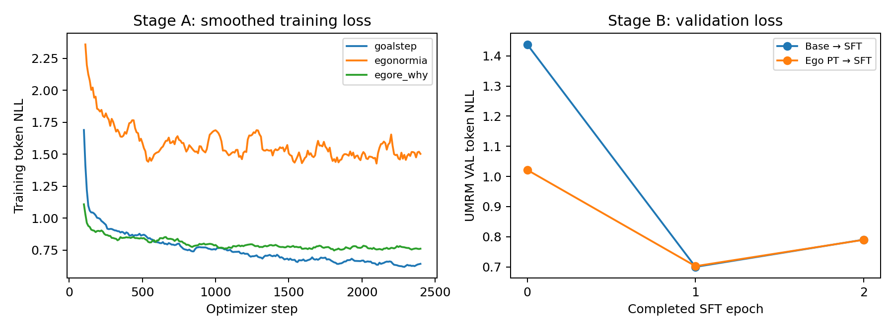

# Ego 因果预训练分析：学到了什么，是否有助于后续 OPD

分析更新：2026-10-19 12:09 北京时间。最终探针于 12:01:08 完成，`queue_e` 于 12:01:28 正常结束，`logs/e.done` 已生成。四组模型均覆盖全部 1,235 道探针。仅分析已有产物；未运行新模型或修改原登记门。

## 结论

这轮预训练不是无效训练：它显著提高了同域、未见视频上的 EgoNormia 选项判断，也改善了进入 UMRM SFT 前的目标文本似然。但目前没有建立广泛的 ego 理解提升，也没有建立最终动作收益。对于用户提出的“补足学生 ego 理解能力，使其更能吸收特权 reason 教师”的假设，现有结果提供了部分前提证据，尚未进行直接检验。

最终探针显示，当前 UMRM SFT 配方削弱了阶段 A 的部分行为收益：EgoNormia 从 67% 回落到 61.5%，EgoToM actions 从 30.51% 降到 24.29%。最终模型相对原 SFT 的四项区间均跨 0，尚未建立更好的 OPD 起点。建议保留检查点，优先检查 SFT 的能力保留，再围绕固定教师进行匹配 OPD 对照；不宜直接扩大预训练规模，也不宜仅根据 G-E1 未通过就放弃蒸馏假设。

## 1. 实验到底训练了什么

| 数据来源 | 实际训练条数 | 占比 | 监督内容 |
|---|---:|---:|---|
| Goal-Step | 10,000 | 51.97% | 8 秒前文→目标/刚完成步骤＋下一步 |
| EgoNormia | 1,242 | 6.45% | 反应前最多 5 秒→理由＋正确行为 |
| EgoRe Why | 8,000 | 41.58% | 原视频片段及 why 问题→原答案 |

原计划 19,252 条，10 条 EgoNormia 因窗口不足 2 帧而没有缓存，训练实际 19,242 条。不是随机丢样，短窗口样本被系统性排除；数量很小，但记录中保留这一偏差。模型为 Qwen3-VL-4B，语言侧 r16 LoRA，视觉塔冻结；1 epoch、2,406 次更新、全局每 8 条更新一次。这是领域监督训练，不是全参训练 4B。

审计得到：外部训练 manifest 有 4,059 个不同视频 UID；与 795 个评测侧 UID 的交集为 0，ID 唯一。EgoNormia 200 个正确选项中，只有 1 条与训练 `<next>` 在大小写/标点归一化后完全相同。未发现这种层面的重复视频或大量答案原文复用；这不构成对所有文本近重复或基础模型预训练污染的排除。

三种监督与 UMRM 的关系不同：

- Goal-Step 的 `<reason>` 通常是“正在做薄饼，刚给面团裹粉”等目标和历史步骤模板，主要教任务进程与下一步。
- EgoNormia 更接近当前情境下应采取何种行为，但理由也可能是“施工优先考虑团队协作”等通用解释。
- EgoRe Why 的问题可能已点明正在发生的动作，例如“为什么左手反复把刷子蘸进油漆罐”。它可以教动作解释，不能全部视作严格的反应前预测监督。

所以“学习到了 ego 领域知识”与“学到了可以迁移至身体反应的因果推理”需要分别验证。目前没有“同视频同下一步、去掉理由”的对照，不能将全部收益归因于 reason 的因果内容。

## 2. 外部探针：最可靠的正结果在 EgoNormia

探针按每个候选的平均 token 对数概率选答案，所有模型使用相同提示；不评价生成理由的正确性，也不是直接测量模型的因果机制。

| 探针 | 题数 | 原版 4B | 原 SFT | 阶段 A PT-C | PT-C−原版的 95% CI（百分点） |
|---|---:|---:|---:|---:|---|
| EgoNormia verified | 200 | 53.00% | 60.00% | **67.00%** | **+14.00 [+7.84,+20.41]** |
| EgoToM actions | 354 | 28.25% | 25.99% | 30.51% | +2.26 [−1.13,+5.75] |
| EgoToM belief | 332 | 21.99% | 20.78% | 25.30% | +3.31 [−0.60,+7.12] |
| EgoToM goal | 349 | 42.69% | 43.55% | 41.83% | −0.86 [−4.69,+3.19] |

EgoNormia 从 106/200 到 134/200：36 道原本错误的题被修正，8 道原本正确的题变错，净增加 28 题。按 183 个视频 UID 聚类的配对 bootstrap 区间不跨 0。与旧 SFT 相比也是 26 题修正、12 题退化，净增加 14 题；+7.00 个百分点，探索性 CI [+1.03,+12.94]。因此收益不只是相对于未经任务训练的原版才出现。

例如，固定候选判断由“拿花束去柜台付款”改为正确的“接过冰淇淋并感谢对方”，由“把木块拼装起来”改为正确的“用工具把木头切成小块”。这些是相对探针答案的改善，未在本次分析中重新人工看视频确认。

EgoToM 跨任务迁移较弱。合并 1,035 题（事后描述性分析，按 621 个 UID 聚类）为 31.11%→32.66%，+1.55 个百分点，CI [−0.67,+3.76]。不能宣布普遍提升。PT-C 相对旧 SFT 在 actions、belief 上的探索性区间分别为 [+0.86,+8.07]、[+0.61,+8.50] 个百分点，但比较包含了旧 SFT 本身低于原版的因素，且未做多重比较校正。

还存在一个输入限制：EgoNormia 窗口中位数 5 秒，而 EgoToM 约 199 秒，两者都只抽 16 帧。长视频中关键的中间事件可能被漏掉；因此 EgoToM 表现弱既可能反映能力不足，也可能反映采样和任务不匹配。belief 的 25.30% 也只在其 25% 随机水平附近。

目前未做去视频、错配视频或文本先验对照。上述正结果证明的是现有视频条件下的选项判断改善；尚不能把它完全归因于视觉证据利用增强，也不能将同域监督迁移等同于通用因果理解。

### 阶段 B 最终探针：部分收益在 SFT 后减弱

| 探针 | 原 SFT | PT-C | PT-C→SFT | 最终−原 SFT 的 95% CI（百分点） |
|---|---:|---:|---:|---|
| EgoNormia verified | 60.00% | 67.00% | 61.50% | +1.50 [−3.59,+6.67] |
| EgoToM actions | 25.99% | 30.51% | 24.29% | −1.69 [−4.32,+0.86] |
| EgoToM belief | 20.78% | 25.30% | 23.49% | +2.71 [−0.30,+5.87] |
| EgoToM goal | 43.55% | 41.83% | 43.27% | −0.29 [−4.07,+3.40] |

表内区间来自最终 `gates_e.json`。四项均跨 0；这表示没有建立最终优于原 SFT 的证据，不表示已经证明两模型等效。EgoToM 合并为最终 315/1,035、原 SFT 313/1,035，仅差 +0.19 个百分点，事后聚类 CI [−1.58,+2.01]。

另按视频 UID 对最终与 PT-C 做配对 bootstrap，观察能力保留：

- EgoNormia：134→123 题，9 题修正、20 题退化，−5.50 个百分点，CI [−10.77,0.00]。回落明显，但区间触及 0，不能将它单独表述为明确显著的遗忘。
- EgoToM actions：108→86 题，6 题修正、28 题退化，−6.21 个百分点，CI [−9.35,−3.14]。这是较清楚的行为退化信号。
- belief：84→78，−1.81 个百分点，CI [−5.05,+1.51]；goal：146→151，+1.43 个百分点，CI [−1.82,+4.75]。
- EgoToM 合并：338→315，−2.22 个百分点，CI [−4.17,−0.38]。以上保留分析为事后比较，未做多重校正。

因此当前有依据说“部分探针能力经过任务 SFT 后退化”，但不能据此断言内部 ego 表征被全部擦除。相对原版，最终 EgoNormia 仍提高 8.5 个百分点，登记 CI [+2.06,+15.20]；不过原 SFT 本身已提高 7 个百分点，预训练额外贡献在最终检查点上没有得到确认。下一步需要关注收益能否到达实际进入 OPD 的学生，而不只看阶段 A 检查点。

## 3. 训练稳定，且确实改善了进入 SFT 前的状态

三个 rank 的训练日志没有数值发散。前 100 步与最后 100 步日志窗口均值如下（对窗口均值再平均，非精确样本加权均值）：

| 来源 | 初期训练 NLL | 末期训练 NLL |
|---|---:|---:|
| Goal-Step | 1.689 | 0.642 |
| EgoNormia | 2.436 | 1.495 |
| EgoRe Why | 1.108 | 0.760 |

损失下降本身只说明拟合了训练任务。没有外部预训练验证损失曲线，不能仅凭训练平台期断言已经最优，或断言还需更多 epoch。

更有价值的是 UMRM 验证集的 teacher-forced NLL：

| 已完成 UMRM SFT epoch | 原版→SFT | PT-C→SFT |
|---|---:|---:|
| 0（尚未做任务 SFT） | 1.4380 | **1.0216** |
| 1 | **0.6998** | 0.7023 |
| 2 | 0.7902 | 0.7898 |

预训练把起点 NLL 降低约 29%，说明其影响超出了外部探针的单一分数，至少改善了 UMRM 正确答案文本的条件似然。但两条路线到 epoch1 后几乎重合，到 epoch2 都变差，均选择 epoch1。预训练没有在当前 SFT 配方下提高最佳验证似然，也没有明显缓解后期过拟合。

这种收敛可能是任务 SFT 将两种初始化带到了相似解，也可能与先前能力被覆盖有关；NLL 接近不能证明内部表征相同。NLL 的变化可能包含语言风格和输出格式适应，不能单独解释成视觉理解改善。现已完成的阶段 B 探针提供了独立的行为证据：部分能力回落，尤其 actions；仍不能由此确定内部机制。

## 4. 最终动作：目前没有一致收益，也有退化信号

当前动作评测保持同一个 A36 头，VAL 125 条、34 个来源，每条生成 3 次。以下原登记主指标区间来自 `gates_e.json`；新增几何/字段分析是事后诊断。

| 指标 | 原 SFT | PT-C→SFT | 判断 |
|---|---:|---:|---|
| R@10 ↑ | 0.2907 | 0.3040 | +0.0133，CI [−0.0511,+0.0827]；G-E1 不通过 |
| t2m 相似度 ↑ | 0.1942 | 0.1819 | 数值下降，CI 跨 0 |
| 同类 R@3 ↑ | 0.2373 | 0.2320 | 无明显收益 |
| 平均检索排名 ↓ | 37.605 | 40.723 | 数值变差，CI 跨 0 |
| MPJPE（m）↓ | 0.6592 | 0.6293 | 数值改善，新增 CI [−0.1172,+0.0393] 跨 0 |
| 终点误差（m）↓ | 1.1160 | 1.0466 | 数值改善，新增 CI 跨 0 |
| 五字段计划准确率 ↑ | 0.6368 | 0.6128 | −0.0240，CI [−0.0509,+0.0033] |

R@10 的差异是 375 次生成从 109 次命中增加到 114 次。按样本平均，19 条提高、19 条下降、87 条未变。这些生成不是 375 个独立视频；统计仍按 125 条样本及 34 个来源处理。不能把增加 5 次命中描述成稳定改善，也不能把未显著简单理解为已证明完全无效。

计划方向出现较清楚的事后负信号：56%→48%，3 条修正、13 条退化，来源聚类 CI [−14.16,−2.65] 个百分点（五字段比较未校正）。预测 forward 从 83/125 到 88/125，真值为 43/125；direction TV 从 0.336 到 0.368。duration=2.5 从 78 条到 83 条，真值 49 条；duration TV 从 0.232 到 0.272。暂不称为普遍塌缩，但应作为后续 OPD 的分布偏移监控项。

注意：A36 头直接使用的 plan 字段只有 duration，direction 没有直接作为动作约束。因此方向字段下降是 VLM 决策诊断，不能机械地解释成动作头方向已经下降了同样幅度。

逐样本文本诊断同时发现收益与损失；TMR 改善不等于完整反应决策正确。明细留在服务器，本次没有做视频/动作人工复核。

## 5. 对用户的 OPD 假设能说明多少

用户假设是：学生 ego 理解不足，使其无法从特权 reason 教师的分布学到有效策略；预训练先改善学生能力，随后 OPD 才有机会有效。

| 假设链上的环节 | 当前证据 |
|---|---|
| 预训练确实改变了模型，且部分相关能力变好 | 支持：EgoNormia +14 个百分点，UMRM SFT 前 NLL 下降 |
| 形成了广泛的视觉/因果理解改善 | 证据有限：EgoToM 对原版无显著提升，缺视觉消融和 reason 内容对照 |
| 能力经过 UMRM SFT 后仍保留 | 保留不足：EgoNormia 数值回落，actions 有明确事后退化信号；最终四项均未建立优于旧 SFT 的证据 |
| 保留的能力使特权 reason 更容易蒸馏 | 尚未测：本轮队列没有 OPD |
| 改善最终动作质量 | 当前未建立：G-E1 不通过，其他指标没有一致支持 |

因此这轮可以评价为“有针对性的学习收益，但后续蒸馏价值尚待验证”。它值得保留为初始化候选，证据还不足以支持直接扩大训练规模或宣布已经解决原来的 OPD 问题。

下一步按信息价值排序：

1. 最终探针已齐，优先检查 SFT 的能力保留：可预先登记较低学习率、较短 SFT 或少量 ego 回放的受控比较，兼顾 UMRM VAL 与外部探针，避免为保留单个探针分数牺牲任务能力。这些只是候选方案，尚未启动。当前结果不能直接解释为 ego 预训练无价值。
2. 检验“有/无 ego 预训练 × 有/无 OPD”，固定同一个 4B reason 教师、特权内容、KL 配方、预算与 A36 头。同时看 `(D−C)` 和 `(D−C)−(B−A)`。历史版本的教师和配方不同，不能直接拼成干净对照。
3. 若要把收益归因于“视觉理解”和“reason 因果内容”，再分别做错配/去视频诊断及匹配的数据目标对照；这些是新的实验，当前没有执行。

特别是：学生只通过教师的输出分布获得指导，不会直接读到教师 reason。预训练可能让它更能从图像提取线索，但无法补出视频未提供的私人意图、未来信息或音频。教师 reason 的可观测部分仍需区分清楚。

## 复核与复现

- [metrics.json](metrics.json)：完整统计、时间戳、输入 SHA256；逐样本变化保存在服务器本地 `cases.json`，不随公开代码发布。
- [分析脚本](../../../analysis/analyze_ego_pretraining.py)：CPU 离线读取已完成产物，不运行模型；包含样本覆盖、标签、视频 UID 隔离和汇总一致性断言。语法检查和本次实际分析均通过。
- [原登记门](../gates_e.json)：未改写。
- Bootstrap 为 4,000 次，按视频 UID 或 UMRM 来源聚类。新比较与子组分析均为探索性，未多重校正；区间反映当前固定模型的样本不确定性，不涵盖跨训练种子波动。
- 报告仅覆盖实验版 v1197aug 的 VAL 与外部探针，不改动正式 636 benchmark，不评测封存 TEST。
